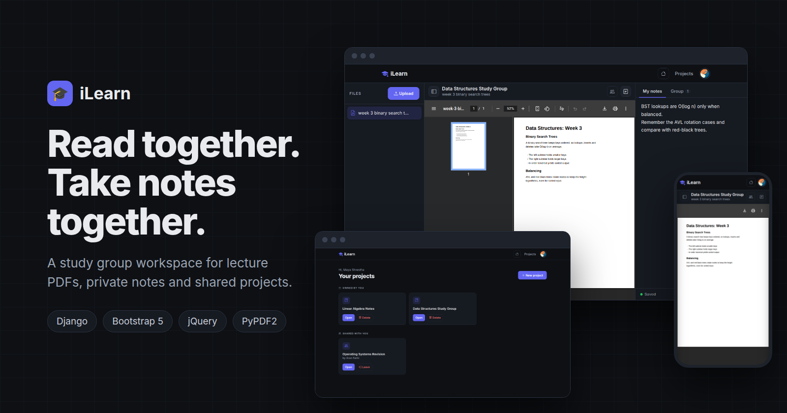
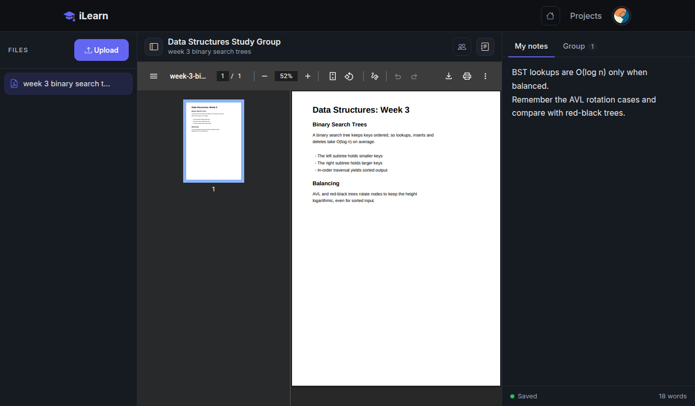
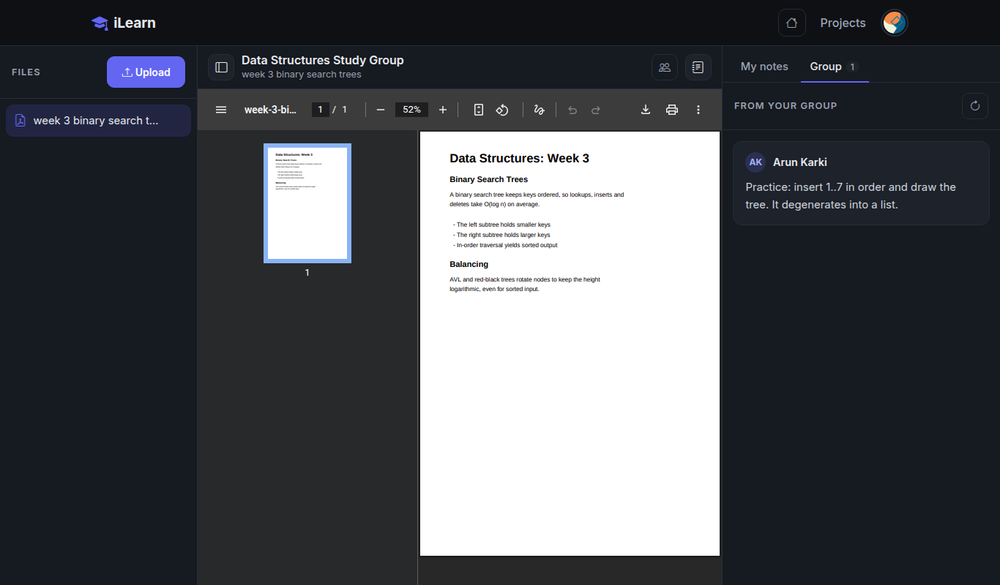
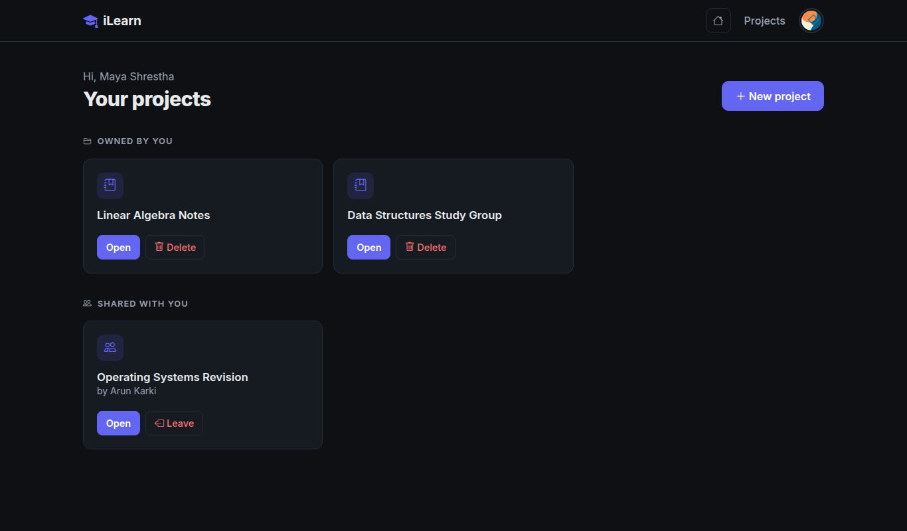
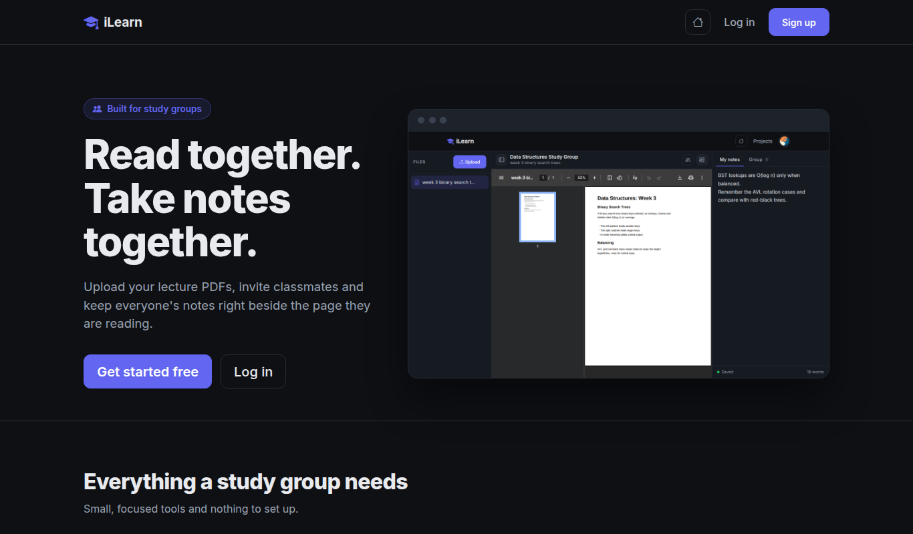
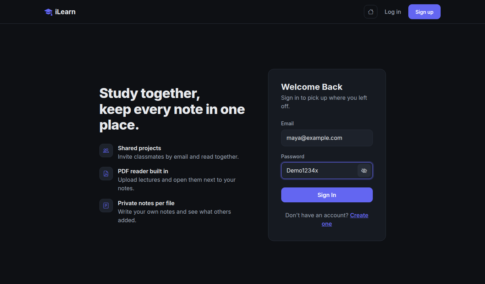
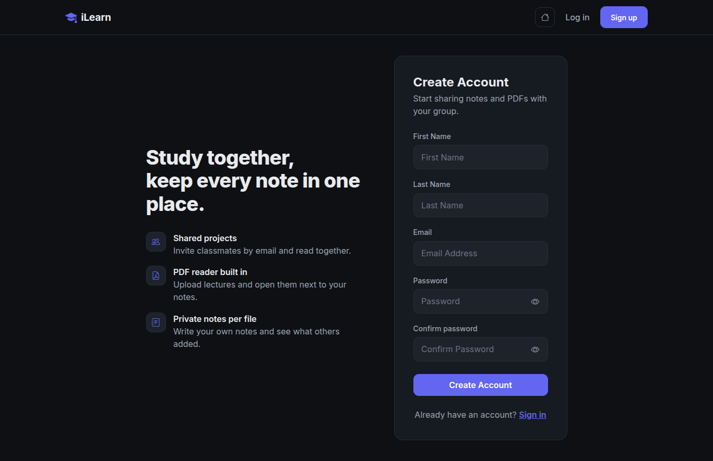
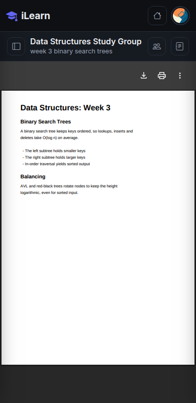

<p align="center">
  
</p>

<h1 align="center">iLearn</h1>

<p align="center">
  A study group workspace for lecture PDFs, private notes and shared projects.<br>
  Upload a PDF, invite your classmates and keep everyone's notes right beside the page.
</p>

<p align="center">
  
  
  
  
</p>

## Why iLearn

Study groups usually end up with slides in one app, notes in another and a chat full of "which page was that?". iLearn keeps the three together: the document, your own notes and what the rest of the group wrote about the same file.

## Features

- **Project workspaces.** One project per course or study group, with an owner and invited members.
- **Built-in PDF reader.** Open lectures and textbooks in the browser. Drag and drop to upload, up to 50 MB per file.
- **Notes that save themselves.** Write beside the page. Notes autosave as you type, save on `Ctrl+S`, and are never lost when you switch files or close the tab.
- **Group notes.** A second tab shows what each member wrote for the same file, refreshed automatically.
- **Private by default.** PDFs are cleaned on upload and served only to project members through a permission check. Nothing is public under `/media`.
- **Simple accounts.** Sign up and sign in with an email address. Password fields have a show/hide toggle.
- **Responsive.** The files and notes panels collapse into drawers on phones.

## Screenshots

### Reader

Files on the left, the PDF in the middle and your notes on the right. Panels can be collapsed to give the page more room.



### Group notes

See what everyone else wrote for the same document.



### Projects



### Landing page



### Sign in and sign up

<p>
  
  
</p>

### On your phone

<p align="center">
  
</p>

## Tech stack

| Layer | Tools |
| --- | --- |
| Backend | Django 5.1, SQLite, PyPDF2 |
| Frontend | Bootstrap 5, Bootstrap Icons, jQuery, vanilla JavaScript |
| Auth | Django auth with email login |

## Getting started

```bash
git clone https://github.com/himaldahal/ilearn.git
cd ilearn

python -m venv venv
source venv/bin/activate          # Windows: venv\Scripts\activate

pip install -r requirements.txt
python manage.py migrate
python manage.py runserver
```

Open <http://127.0.0.1:8000>, create an account and make your first project.

### Configuration

Defaults are set up for local development. For a real deployment set these environment variables:

| Variable | Purpose | Default |
| --- | --- | --- |
| `DJANGO_SECRET_KEY` | Secret key used for signing | insecure dev key |
| `DJANGO_DEBUG` | `1` to enable debug mode, `0` to disable | `1` |
| `DJANGO_ALLOWED_HOSTS` | Comma separated host names | `*` in debug, empty otherwise |

To use the admin site, run `python manage.py createsuperuser` and visit `/admin/`.

## How it works

1. **Create a project** and give it a name.
2. **Upload PDFs** and add members by email. Only the owner can manage members.
3. **Read and write.** Pick a file, take notes in the right panel and check the Group tab for notes from others.

## Project structure

```
ilearn/
├── ilearn/      # settings and root URLs
├── myauth/      # registration, login and logout
├── reader/      # projects, PDFs, notes and the reader UI
├── templates/   # base template
├── static/      # shared stylesheet and images
└── manage.py
```

## Contributing

Contributions are welcome.

1. Fork the repository.
2. Create a branch for your change.
3. Commit your work and open a pull request.

## License

Released under the MIT License. See [LICENSE](LICENSE).
